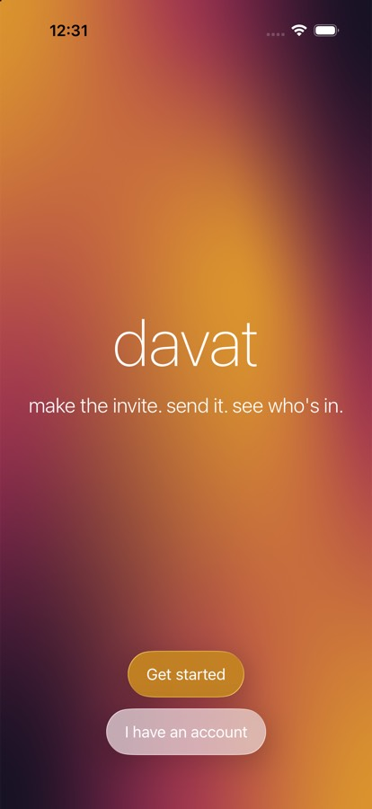
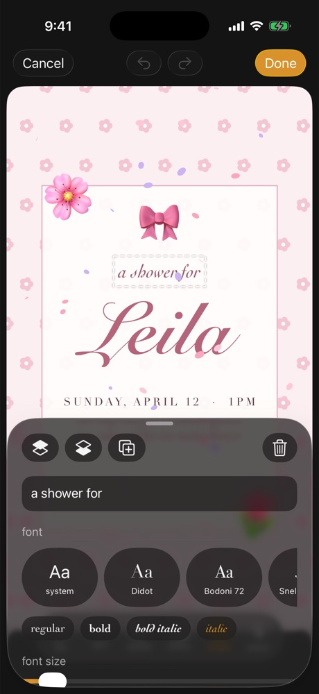
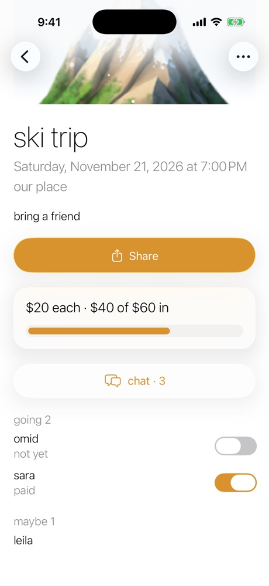
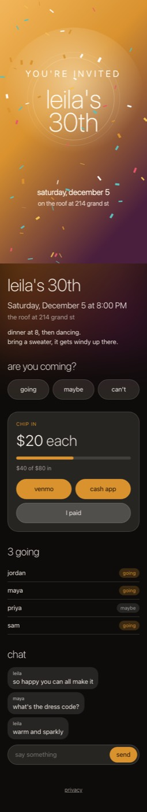

# Davat

Davat (Farsi for "invite") is an iPhone app for designing a custom invite and sending it to friends over iMessage. Friends RSVP with one tap, and when the host is splitting a cost, such as $20 each toward an $80 dinner, each guest chips in their share through Venmo or Cash App while everyone watches the total fill up.

Guests don't need the app. A friend who has Davat answers inside the iMessage bubble. Everyone else gets a link that opens a web page with the same invite.

<p>
  
  
  
  
</p>

From left to right, the screenshots show:
1. the welcome screen;
2. the layer editor;
3. a published invite, as the host sees it, with the fundraiser total and guest list;
4. the guest web page.

A demo of the guest page is live at [davat-app-web.vercel.app/page.html?demo=1](https://davat-app-web.vercel.app/page.html?demo=1).

Stack: SwiftUI on iOS 26, an iMessage extension, a local Swift package (`DavatKit`), Supabase (Postgres, auth, storage, realtime), a static web page with one Vercel function.

## What it does

- **Editor.** The host starts from a blank canvas or one of 13 templates, from disco to delicate floral. Every element is a layer that can be dragged, pinched and rotated:
  - text in about 25 fonts, with outline, shadow, gradient and curved text;
  - stickers, photos and shapes;
  - a background that can be a color, gradient, pattern, photo or an AI image from Apple's Image Playground;
  - animated confetti, snow, sparkle, hearts, bubbles or petals.
- **Sending.** The invite goes out as a live iMessage bubble or as a link, and a pasted link previews with the poster, title and date.
- **RSVP and fundraising.** Guests answer going, maybe or can't. In fundraiser mode the goal is the per-person price times the number of people going. Guests see how much is needed and how much is in, but not who has paid. The host sees who has paid and confirms each payment.
- **Chat.** Each invite has its own chat, shared by the app and the web page.

## How it works

**One design, shown everywhere as one image.** An invite's design is stored as JSON, a background plus a list of layers placed as fractions of the canvas, so it stays editable. On publish, the app also renders a 1080x1920 PNG poster. The web page, link previews and the iMessage bubble only ever show that PNG. As a result, the invite looks identical in all three places, and nothing outside the app has to reimplement the renderer. The tradeoff is that the poster's text isn't selectable on the web, while the event details below it are real text. Decoding skips layer kinds that the running build doesn't know, so an older app can still open a design made by a newer one.

**A link is the key.** Invite ids are random UUIDs, so holding the link is what lets someone respond. Row level security gives anonymous users no read access to any table. Guests can only call a handful of database functions that each take an invite id: `get_invite`, `respond`, `invite_public_summary`, `invite_messages` and `post_message`. No query lists invites, and the public summary never says who has paid. A SQL test suite (`supabase/tests/rls.sql`) checks these rules against the hosted database.

**Polling for guests.** Supabase realtime passes through row level security, so only the signed-in host receives live change events. Guests poll every 4 seconds instead, on the web page (only while the tab is visible) and in the extension. They see changes a few seconds late, and in return guests never get direct read access to any table.

**The iMessage bubble updates in place.** The extension sends the invite as an `MSMessage` on an `MSSession`. When a guest answers, it posts on the same session, so Messages replaces the bubble with one showing the latest state ("sara's in · 3 going · $60 of $80") instead of stacking up new ones. Tapping "I paid" deliberately leaves the bubble alone, since updating it would tell the whole thread who paid.

**Money is integer cents, and Davat never holds it.** Prices, goals and totals are integer cents end to end, in Swift, SQL and JavaScript. The pay buttons open a Venmo or Cash App link to the host's handle with the amount filled in. The guest taps "I paid", and the host can switch that off for anyone who didn't actually pay.

**Two backends behind one protocol.** The app, the extension and the tests all talk to a `Backend` protocol, which has two implementations:
- `SupabaseBackend`, used in production;
- `LocalBackend`, which stores JSON files on the device.

Because of the local version, the whole host flow could be built and tested before any server existed.

**Web page.** `web/` is static HTML and JavaScript with no build step and no npm dependencies. A single Vercel function returns the page with Open Graph tags filled in for each invite.

## Status

Working:
- The app runs against a live Supabase project, and the guest web page is deployed on Vercel.
- A published invite opens from its link, and a web RSVP shows up in the host's app.
- The row level security tests pass on the hosted database.
- 43 Swift tests, 11 web tests and a UI test that taps through the whole host flow all pass.

Not yet done:
- The app isn't on TestFlight or the App Store.
- Sign in with Apple and the iMessage bubble between two real phones are waiting on a signed device build.
- There's no in-app payment and no push notification for new RSVPs.

## Running it

Requires Xcode 27 or later with an iOS 26 simulator, [XcodeGen](https://github.com/yonaskolb/XcodeGen), and Node for the web tests.

```sh
brew install xcodegen
xcodegen generate
open Davat.xcodeproj                 # run the Davat scheme on an iPhone simulator
(cd DavatKit && swift test)          # models, fundraiser math, payment links
node --test web/test                 # payment links and the link preview function
```

The checked-in config points at the project's own Supabase backend. With `SupabaseURL` and `SupabaseAnonKey` left empty in `project.yml`, the app runs on `LocalBackend` instead. [docs/supabase-setup.md](docs/supabase-setup.md) covers setting up a new Supabase project and deploying the web page.
