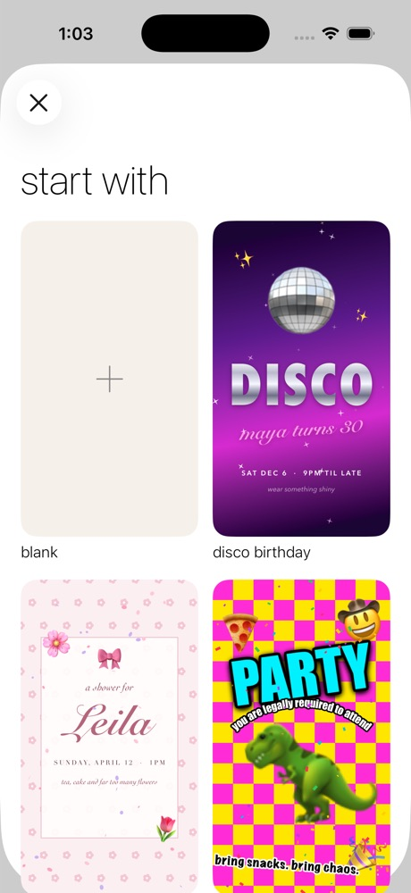
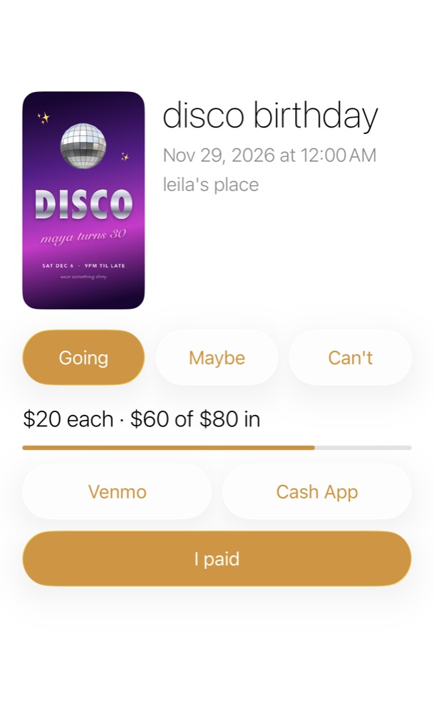

# Davat

Davat is an iPhone app and iMessage extension for making a custom invite, sending it as a link, and seeing who is coming. A host can also turn an invite into a group fundraiser, where each guest owes a share of a cost and pays the host through Venmo or Cash App.

<p>
  
  
  
  
</p>

Left to right: the template picker, the layer editor, a published invite as the host sees it, and the guest card the iMessage extension shows (rendered in a harness, not inside Messages).

Stack: SwiftUI on iOS 26, a local Swift package (`DavatKit`), Supabase (Postgres, auth, storage, realtime), a static web page with one Vercel function, XcodeGen.

## Quickstart

Prerequisites: macOS with Xcode 27 or later, an iOS 26 simulator (the commands below use iPhone 17 Pro on iOS 26.5), XcodeGen, and Node for the web tests (tested with Node 26).

```sh
brew install xcodegen
xcodegen generate
xcodebuild -project Davat.xcodeproj -scheme Davat \
  -destination 'platform=iOS Simulator,name=iPhone 17 Pro,OS=26.5' build CODE_SIGNING_ALLOWED=NO
(cd DavatKit && swift test)          # models, fundraiser math, payment links, LocalBackend
node --test web/test                 # payment links and the link preview function
```

With no Supabase keys configured the app runs on `LocalBackend`, which stores everything as JSON files on the device, so the whole host flow works in the simulator without an account anywhere. `xcodebuild ... test` runs one UI test that taps through template, editor, details and publish against that local store.

The guest web page runs from a plain static server and shows a built-in demo invite when it has no keys:

```sh
python3 -m http.server 4173 -d web    # then open http://localhost:4173/page.html?demo=1
```

## Backend setup

`docs/supabase-setup.md` walks through it step by step. In short:

1. Create a Supabase project and run `supabase/migrations/0001_init.sql` in the SQL editor. `supabase/tests/rls.sql` checks the access rules.
2. Copy the Project URL and the `anon` key from Project Settings > API. Put them in `SupabaseURL` and `SupabaseAnonKey` under both targets in `project.yml`, then run `xcodegen generate`. Put the same two values in `web/config.js`, or set `SUPABASE_URL` and `SUPABASE_ANON_KEY` in Vercel. Both are public values; the `service_role` key never goes in the app or the page.
3. Deploy `web/` to Vercel as the project root. `/i/:id` is rewritten to `web/api/invite.js`.

Placeholders to replace before a release:

- `TEAMID` in `web/.well-known/apple-app-site-association` (the Apple developer team id), so invite links open the app.
- `app-id=0` in the `apple-itunes-app` meta tag in `web/api/invite.js` (the App Store id).
- The contact address in `web/privacy.html`.
- `davat.vercel.app` in `DavatConfig.webBaseURL` and the associated domains entry in `project.yml`, if the site lives elsewhere.

## How it works

**One design, two forms.** An invite's design is JSON: a background plus a list of layers (text, emoji, image, shape) placed as fractions of the canvas. The app keeps editing that JSON. On publish it also renders a 1080x1920 PNG poster and uploads it under a fixed path per invite. The web page, link previews and the iMessage bubble only ever show the PNG, so the invite looks the same everywhere and nothing outside the app has to reimplement the renderer. The cost is that a design change needs a republish, which overwrites the PNG behind the same link. Decoding drops layer kinds the running build does not know, so an older app can still open a newer design.

**Two backends behind one protocol.** `Backend` in `DavatKit` has two implementations. `LocalBackend` is file based and used for development, tests and the simulator. `SupabaseBackend` is used when the Info.plist keys are set. The app, the iMessage extension and the tests all talk to the protocol, which is why the app could be built and exercised end to end before any server existed.

**Guests only get RPCs.** Row level security gives the `anon` role no read access to any table; its only direct write is an insert into the write-only `reports` table. A guest can call `get_invite`, `respond`, `invite_public_summary`, `invite_messages` and `post_message`, each of which takes an invite id. Invite ids are random UUIDs, so a link works as a capability: anyone holding it can RSVP, but there is no query that lists invites, and the public summary never says who has paid. Guests are anonymous; a random token kept in `localStorage` (or in the extension's defaults) lets them change their answer later.

**Polling for guests.** Supabase realtime goes through RLS, so only the signed-in host receives change events. Guests poll every 4 seconds instead, on the web page (only while the tab is visible) and in the extension. This keeps anon access to the RPCs above at the cost of a few seconds of lag.

**The iMessage bubble updates in place.** The extension sends the invite as an `MSMessage` on an `MSSession` with the poster as its image. When a guest answers from the bubble, the extension posts a new message on the same session, so Messages replaces the bubble with one that carries the latest caption ("sara's in · 3 going · $60 of $80") instead of stacking up new ones.

**Money is integer cents.** Prices, goals and totals are `Int` cents end to end, in Swift, SQL and JavaScript. The goal is the per-person price times the people going (plus the host if they pay too). Davat moves no money: the pay buttons open a prefilled Venmo or Cash App link to the host's handle, the guest taps "I paid", and the host confirms with a switch on the guest list.

**Web page.** `web/` is static HTML and JS with no build step and no npm dependencies. The Vercel function fetches the invite and returns the page with Open Graph tags, so a pasted link previews with the poster and date. The page also has a "report this invite" form that inserts into `reports`, which is read from the Supabase dashboard. The privacy policy is `web/privacy.html`, linked from the app's profile screen.

## Status

Works locally: the editor, publishing, the host detail screen with guest list, paid switches and chat, account deletion, and the guest web page in demo mode. Logic tests, web tests and the UI test pass on LocalBackend.

Not yet run for real:

- The app has not been pointed at a live Supabase project, and `web/` has not been deployed to Vercel. `supabase/tests/rls.sql` has not been run against a hosted database yet.
- The iMessage flow has not been exercised end to end in Messages between two devices; the extension builds and its views were checked in a harness.
- Sign in with Apple needs a signed build with a development team and the capability enabled, so it has not been tried. Email sign-in is the tested path.

Known limitations: invites store no time zone, so link previews show times in US Eastern. Uploaded images stay in Supabase storage after an account is deleted, since storage objects cannot be removed from SQL. There is no in-app payment and no push notification for new RSVPs.
